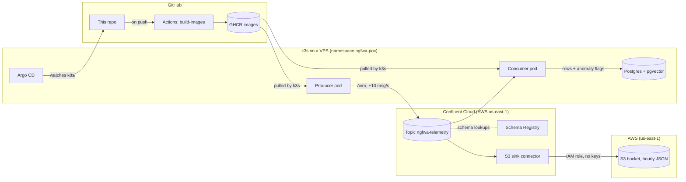

# ngFWA Telemetry Pipeline: Stage 1 POC

A working streaming pipeline on Confluent Cloud. Synthetic fixed-wireless-access (FWA) telemetry is produced as Avro against a Schema Registry data contract, landed hourly in an S3 data lake by a managed connector, and screened for anomalies by a consumer that writes to Postgres with pgvector. The producer, consumer and database run on a single-node k3s cluster, deployed by Argo CD from this repo.

All data is synthetic, and everything runs on personal accounts and infrastructure. Nothing here comes from any employer.

## Architecture



| Piece | Runs on | Role |
|---|---|---|
| Producer | k3s pod | Emits readings for 20 simulated devices every 2 s; about 3% are deliberately degraded |
| Topic `ngfwa-telemetry` | Confluent Cloud, Basic cluster | 6 partitions, keyed by device ID so each device's readings stay in order |
| Schema Registry | Confluent Cloud | Avro data contract `ngfwa-telemetry-value`, backward-compatible |
| S3 sink connector | Confluent Cloud (managed) | Writes hourly JSON files to S3; authenticates by assuming an IAM role |
| Consumer | k3s pod | Applies threshold rules, writes every reading to Postgres, flags anomalies |
| Postgres + pgvector | k3s StatefulSet | Event store for Stage 2's AI agent; schema created on first start |
| Argo CD | k3s | Keeps the cluster in sync with `k8s/` on `main` (auto-sync, prune, self-heal) |
| GitHub Actions | GitHub | Builds both images on every app-code push; tags each with `sha-<commit>` |

## Data contract

Defined in `schema/telemetry-value.avsc`:

| Field | Type | Meaning |
|---|---|---|
| `device_id` | string | Subscriber terminal, e.g. `CPE-00042` (also the message key) |
| `sector_id` | string | Serving sector, e.g. `SITE-02-A` |
| `event_time` | timestamp-millis | When the reading was taken |
| `signal_strength_dbm` | float | Received signal strength |
| `snr_db` | float | Signal-to-noise ratio |
| `sector_load_pct` | float | Serving sector load |
| `link_state` | enum | `UP`, `DEGRADED`, `DOWN` |

The consumer flags a reading when the link isn't `UP`, signal is below -105 dBm, SNR is below 5 dB, or sector load is above 95%. Thresholds live in `k8s/configmap.yaml`.

## Repo layout

```
producer/        synthetic telemetry producer (Python, confluent-kafka) + Dockerfile
consumer/        anomaly-flagging consumer -> Postgres/pgvector + Dockerfile
schema/          Avro schema registered in Schema Registry
k8s/             everything Argo CD applies: namespace, config, deployments,
                 Postgres StatefulSet and its schema
argocd/          the Argo CD Application pointing at k8s/ on main
templates/       secret template, kept outside k8s/ so Argo CD never applies it
aws/             IAM policy for the S3 sink connector's role
.github/         image build workflow
```

## How a change reaches the cluster

1. App code changes (`producer/`, `consumer/`, `schema/`) trigger **GitHub Actions**, which builds both images and pushes them to GHCR as `sha-<commit>` and `latest`.
2. The deployments pin an exact `sha-` tag. Rolling out a new build is a one-line commit changing that tag.
3. **Argo CD** notices any commit under `k8s/` (it polls about every 3 minutes) and applies it. Pods roll without downtime.

Demonstrated on Oct 15, 2026: a single commit raised the producer's injected anomaly rate from 3% to 10%. Argo CD rolled out a new pod about 2 minutes after the push, and the share of rows the consumer flagged in Postgres moved from 3.1% to 9.7%. (The synthetic anomalies are cleanly separable from normal readings, so the flagged rate tracks the injected rate. This demonstrates the rollout, not detection accuracy.)

## Security choices

- **No secrets in Git.** Kafka, Schema Registry and database credentials live in Kubernetes Secrets created by hand on the cluster. `templates/secret.example.yaml` shows the shape.
- **No AWS keys.** The S3 connector assumes an IAM role that trusts only Confluent's integration role, conditioned on an external ID. The role can only write to this one bucket.
- **Scoped API keys.** The Schema Registry key is scoped to Schema Registry, not global.
- **Nothing exposed that doesn't need to be.** The VPS firewall allows SSH only. The Kubernetes API, Postgres and the Argo CD UI are reached through SSH tunnels.
- **Non-root containers** (uid 10001).

## Run it yourself

You need a Confluent Cloud account, an AWS account, a small Linux VPS (2 vCPU / 4 GB is enough), and a fork of this repo.

1. **Kubernetes:** install k3s on the VPS. Allow pod and service traffic through the host firewall (`10.42.0.0/16`, `10.43.0.0/16`).
2. **Confluent Cloud:** create a **Basic** cluster (onboarding may default to Standard, which bills hourly), the topic `ngfwa-telemetry`, and the value schema from `schema/telemetry-value.avsc`. Create one Kafka API key and one Schema Registry API key.
3. **AWS:** create a bucket, then the IAM policy in `aws/` (replace `<aws-account-id>` with your bucket's suffix), and a role through Confluent's provider-integration wizard.
4. **Connector:** add the Amazon S3 Sink: input AVRO, output JSON, TimeBasedPartitioner hourly, flush size 1000, IAM-role authentication.
5. **Secrets on the cluster:**
   ```bash
   kubectl -n ngfwa-poc create secret generic postgres-auth \
     --from-literal=POSTGRES_USER=ngfwa \
     --from-literal=POSTGRES_PASSWORD="$(openssl rand -hex 24)" \
     --from-literal=POSTGRES_DB=ngfwa_poc
   kubectl -n ngfwa-poc create secret generic ngfwa-poc-secrets --from-env-file=<your env file>
   ```
   The env file holds the variables listed in `templates/secret.example.yaml`. `DATABASE_URL` points at `postgres:5432`.
6. **Argo CD:** install it (`kubectl apply -n argocd --server-side -f` the release's `install.yaml`), point `argocd/application.yaml` at your fork, and apply it.

To run the producer or consumer on a laptop instead, export the same variables and run `python producer/producer.py` or `python consumer/consumer.py` in a virtualenv with the matching `requirements.txt`. Reach Postgres through a tunnel:

```bash
ssh -t -L 15432:127.0.0.1:15432 root@<vps-ip> \
  'kubectl -n ngfwa-poc port-forward svc/postgres 15432:5432'
```

## Demo walkthrough

1. **Argo CD tree view:** every resource deployed from Git, Synced and Healthy.
2. **Confluent Cloud Stream Lineage:** producer → topic → S3 sink connector and consumer group.
3. **S3:** `topics/ngfwa-telemetry/year=…/month=…/day=…/hour=…/`, one file per partition per 1,000 records.
4. **Postgres:**
   ```sql
   SELECT count(*), count(*) FILTER (WHERE is_anomaly) AS anomalies
   FROM telemetry_events;
   ```
5. **GitOps change:** edit `ANOMALY_RATE` in `k8s/producer-deployment.yaml`, commit, push, and watch Argo CD roll out the new pod and the anomaly share move.

## Cost (approximate, Oct 2026)

| Item | Cost |
|---|---|
| Confluent Cloud Basic cluster | first eCKU free; under $1/month at this volume |
| S3 sink connector | $0.035/task-hour plus $0.025/GB, about $0.85/day |
| VPS (2 vCPU / 4 GB) | about $20/month |
| S3 storage, GitHub, GHCR | pennies, or free |

A Standard cluster would have added about $540/month in base charges for no benefit at this scale.

## Known limitations and next steps

- Personal API keys; production would use service accounts with ACLs and role bindings.
- JSON output in S3; Parquet or Tableflow's Iceberg tables would make it directly queryable by a lakehouse such as watsonx.data.
- The `embedding` column is a placeholder (the three numeric readings as a 3-dimension vector). **Stage 2** adds an AI agent (LangGraph + Claude) with real embeddings, reading from this Postgres to guide engineers through ngFWA integration into carrier OSS/BSS/DSS systems.
- Single node, no TLS inside the cluster, and secrets created by hand rather than from a secrets manager.

## How this was built

I designed the architecture (data contract, anomaly rules, connector and authentication model, GitOps topology, security boundaries) and directed the implementation with Claude Code, an AI coding assistant. I'm not claiming production experience with Confluent or Argo CD; this project is where I built hands-on experience with both.

## Scope

Personal proof of concept. Synthetic data only. Not affiliated with, and contains no data or code from, any current or former employer.
